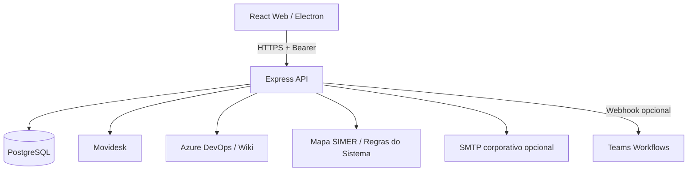

# Arquitetura

## Componentes

- `frontend`: React, Material UI, Vite, Recharts e carregamento sob demanda.
- `backend`: Express, Prisma, serviços de domínio, inteligência e schedulers.
- `desktop`: Electron; inicia o backend embarcado e gerencia atualização.
- `PostgreSQL`: usuários, sessões, tickets, Work Items, sincronizações, chat, configurações, mapas/regras e auditoria.
- Chat, calendário e reuniões são recursos locais do Hub; reuniões não são sincronizadas com Outlook.
- Alertas Teams são opcionais: tickets elegíveis entram em outbox persistente e um worker envia via Teams Workflows quando habilitado e configurado. A operação do Hub não depende do webhook.
- Notícias públicas complementares e consultas ViaCEP/BrasilAPI/GitHub são auxiliares e não alteram os dados oficiais de operação.
- `Azure DevOps`: Work Items, correlação com atendimentos e Wiki usada pela Base de Conhecimento.
- `Mapa SIMER / Regras do Sistema`: fontes internas usadas para investigação técnica e confronto entre implementação, fluxo e evidências.

SharePoint, Planner e Microsoft Graph não fazem parte da arquitetura ativa desta versão. O webhook Teams é uma integração independente, opcional e sem sincronização Graph.

## Limites de confiança

1. O navegador nunca recebe `DATABASE_URL`, PAT, client secret ou chaves internas.
2. Toda rota em `/api`, exceto autenticação inicial, exige sessão válida.
3. A autorização é aplicada no backend; ocultar menus no frontend não é controle de segurança.
4. Canais do chat são filtrados por associação do usuário.
5. A Central de Coordenação exige `ADMIN` ou `COORDENADOR`.
6. Integrações externas utilizam timeouts e não devem bloquear a API indefinidamente.
7. Sinais de recorrência, versão, mapa e regra são evidências de investigação; não constituem conclusão automática de causa ou Bug.
8. A busca global aplica as permissões atuais do usuário ao conteúdo retornado; o frontend não é a fronteira de autorização.

## Execução em múltiplas instâncias

- O scheduler do Azure usa advisory lock transacional no PostgreSQL para impedir execuções simultâneas entre instâncias que compartilham o banco.
- O worker Teams reivindica cada item por atualização condicional atômica e lease com expiração. Uma falha após a entrega externa pode resultar em nova tentativa; considere o envio como pelo menos uma vez.
- Os schedulers Movidesk coordenam prioridade dentro do processo. Até existir um lock distribuído para toda a família Movidesk, execute apenas uma instância ativa com os schedulers habilitados. Em múltiplas réplicas, desabilite os schedulers duplicados e centralize sua execução.
- Schedulers de referência, enriquecimento e tickets compartilham o coordenador em memória do processo, mas esse coordenador não coordena réplicas distintas.

## Atualização Desktop

O aplicativo usa o canal `beta` para versões RC. A release precisa conter instalador, `.blockmap` e `beta.yml`. O manifesto é validado antes de a release ser promovida.
